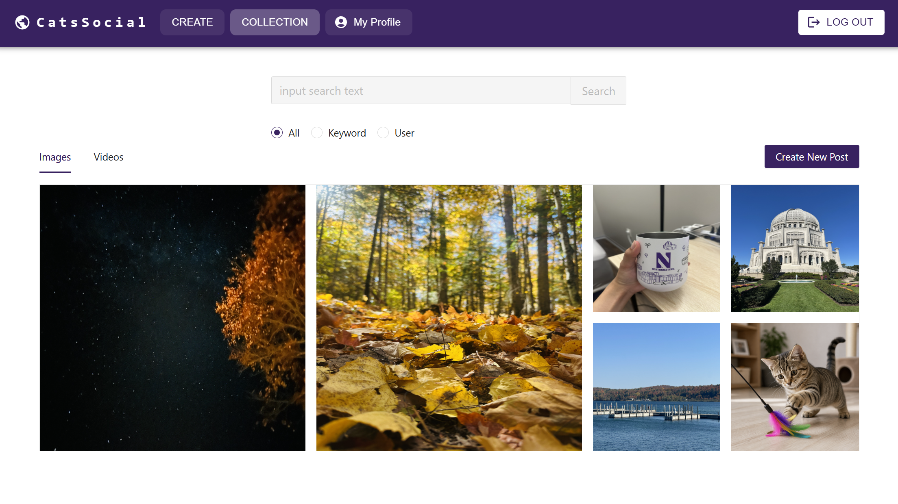
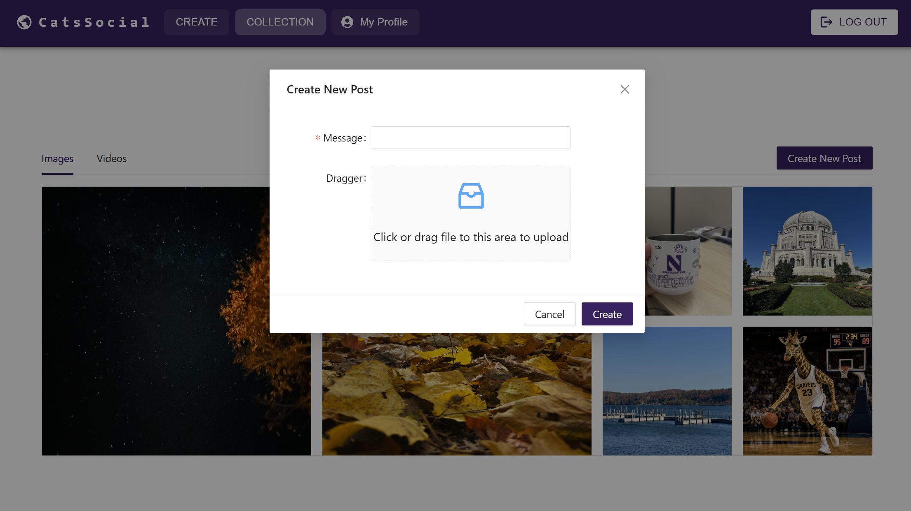
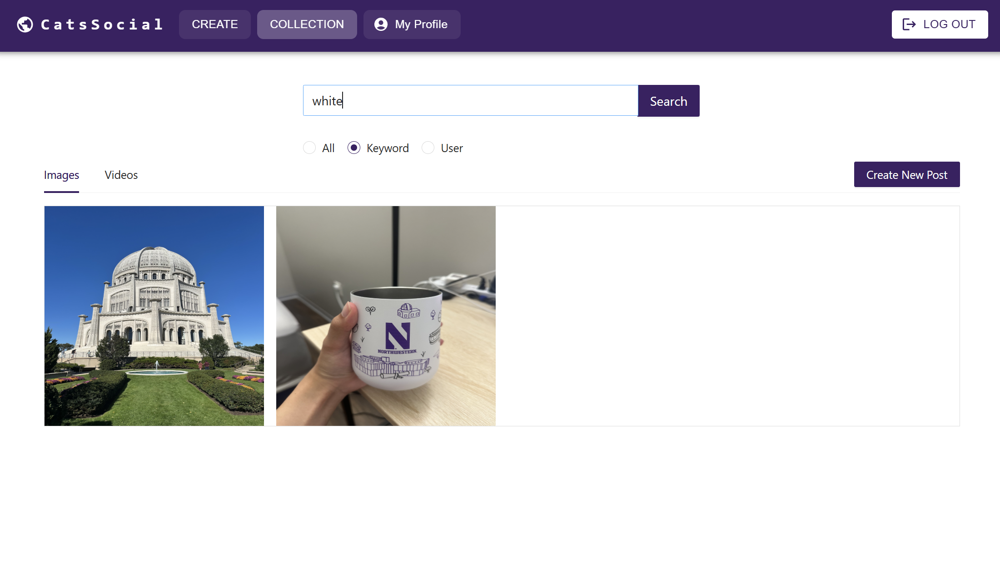

# 🌐 Social AI

A full-stack social media app where users can share images and videos, search posts, and create new images with AI. Built with a **React** frontend and a **Go** backend, using **Elasticsearch** for search and **Google Cloud Storage** for media files.

<!-- Demo video: add later -->

## Screenshots

| AI Image Generation | Collection |
|---|---|
|  |  |

| New Post | Search |
|---|---|
|  |  |

## Features

- **Sign up / log in** with JWT-based authentication (tokens expire after 24 hours)
- **Create posts** with an image or video and a message; media files are stored in Google Cloud Storage
- **Search posts** by keyword (full-text search on the message) or by username
- **Browse** all posts in a photo gallery with an image / video tab view
- **AI image generation**: describe an image in words, generate it with OpenAI, and post it directly

## Tech Stack

| Layer | Technologies |
|---|---|
| Frontend | React 18, React Router, Ant Design, Material UI, axios, react-photo-album |
| Backend | Go, net/http, gorilla/mux, JWT middleware |
| Search & Database | Elasticsearch 7 (Docker) |
| Media Storage | Google Cloud Storage |
| AI | OpenAI image generation API |

## Architecture

```
React frontend (localhost:3000)
        │  REST API + JWT
        ▼
Go backend (localhost:8080)
  handler/   → receives HTTP requests, validates input
  service/   → business logic (sign up, log in, save and search posts)
  backend/   → talks to Elasticsearch and Google Cloud Storage
        │
        ├──► Elasticsearch   stores users and posts, powers search
        └──► Cloud Storage   stores uploaded images and videos
```

## Project Structure

```
SocialAI/
├── social-ai-frontend/      # React app
│   └── src/components/      # Login, Register, Landing (AI), Collection, PostForm ...
└── social-ai-backend/       # Go REST API
    ├── main.go              # entry point
    ├── handler/             # routes and HTTP handlers
    ├── service/             # business logic
    ├── backend/             # Elasticsearch and GCS clients
    ├── model/               # User and Post structs
    ├── constants/           # configuration
    └── docker-compose.yml   # local Elasticsearch
```

## Elasticsearch Indexes

| Index | Fields |
|---|---|
| `user` | `username` (keyword), `password` (keyword), `age`, `gender` |
| `post` | `id` (keyword), `user` (keyword), `message` (**text**, full-text searchable), `url`, `type` |

`message` is a `text` field, so searching "dog" matches a post saying "my cute dog". `user` is a `keyword` field, so searching by username requires an exact match.

## API Endpoints

| Method | Path | Description | Auth |
|---|---|---|---|
| POST | `/signup` | Create an account | No |
| POST | `/signin` | Log in, returns a JWT | No |
| POST | `/upload` | Create a post (multipart form: `message`, `media_file`) | JWT |
| GET | `/search?keywords=...` | Search posts by keyword (empty = all posts) | JWT |
| GET | `/search?user=...` | Search posts by username | JWT |

## How to Run Locally

**Prerequisites:** Go, Node.js, Docker Desktop, the [Google Cloud CLI](https://cloud.google.com/sdk/docs/install), an OpenAI API key

**1. Start Elasticsearch**
```bash
cd social-ai-backend
docker compose up -d
```

**2. Log in to Google Cloud** (used to upload media to Cloud Storage)
```bash
gcloud auth application-default login
```
Set `GCS_BUCKET` in `social-ai-backend/constants/constants.go` to your own bucket name.

**3. Start the backend** (http://localhost:8080)
```bash
cd social-ai-backend
go run main.go
```

**4. Start the frontend** (http://localhost:3000)

Copy `social-ai-frontend/.env.example` to `social-ai-frontend/.env` and add your OpenAI API key, then:
```bash
cd social-ai-frontend
npm install
npm start
```

## Author

Huizeyuanyang — [GitHub](https://github.com/Huizeyuanyang)
